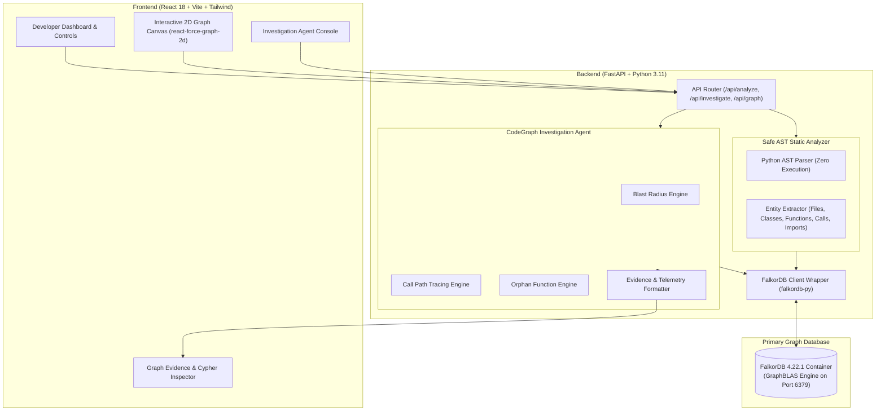

# CodeGraph AI 🔍🕸️
> **Context & Investigation Agent for Connected Codebases**  
> Built for **WeMakeDevs Graph Hacks (Oct 15–18, 2026)**  
> **Target Track:** *Agents That Act on Connected Data*  
> **Primary Database:** FalkorDB (GraphBLAS-Powered Graph Database)

[](https://www.falkordb.com/)
[](https://fastapi.tiangolo.com/)
[](https://react.dev/)
[]()
[]()

---

## 💡 Problem Statement

Modern software repositories are dense webs of interrelated files, classes, methods, and cross-module dependencies. When developers prepare to refactor a core function, investigate a bug, or clean up technical debt, traditional tools offer two flawed extremes:
1. **Dumb Text Grep (`ripgrep` / regex):** Yields thousands of noisy keyword matches with zero understanding of call hierarchy or class inheritance.
2. **Black-Box LLM Chatbots:** Guess dependencies probabilistically, hallucinating functions, missing transitive dependencies, and inventing relationships that do not exist.

Developers need an **Agent that makes decisions you can trace**—an intelligent tool that queries actual code topology and provides **verifiable graph evidence** for every conclusion.

---

## 🚀 What CodeGraph AI Does

**CodeGraph AI** parses Python repositories into an Abstract Syntax Tree (AST)—**without executing any user code**—and models the entire codebase as a directed property graph in **FalkorDB**. 

It then equips developers with a **Connected-Data Investigation Agent** capable of answering critical codebase questions in milliseconds:
* **💥 Blast Radius / Impact Analysis:** *"If I modify `calculate_discount()`, which functions and files across the repository will break?"* (Traverses upstream `CALLS` and `IMPORTS` up to N hops, separating direct from indirect dependencies).
* **🛣️ Execution Path Tracing:** *"How does API route `post_checkout_endpoint` reach external gateway `charge_credit_card`?"* (Finds the shortest verified call chain across modules).
* **🕵️ Dead Code Investigation:** *"Which functions are candidate orphans with zero incoming references?"* (Identifies unreferenced code with confidence scoring and entry-point caveats).
* **🔬 Cypher Evidence Inspector:** Shows the exact raw Cypher query and GraphBLAS execution time (1.3 ms – 17 ms) backing every finding.

---

## ⚡ Why FalkorDB is Central to the Product

Code is inherently a **directed property graph**, not a flat document or tabular relational table. FalkorDB is the engine that makes CodeGraph AI possible:

1. **Sub-Millisecond GraphBLAS Linear Algebra:** FalkorDB represents graphs as sparse matrices and executes graph traversals as matrix multiplications. Transitive impact traversals (`[:CALLS*1..5]`) execute in **under 15 ms**, compared to sluggish multi-table recursive SQL joins.
2. **Native Cypher Query Language:** Enables expressive, declarative reasoning over call paths, shortest paths, and orphan nodes.
3. **Traceable Ground Truth:** The agent’s reasoning is 100% grounded in FalkorDB's graph topology. There is zero hallucination; every node and edge links directly to source file locations and line numbers.
4. **Graph Isolation:** Multiple repositories can be indexed and analyzed concurrently in isolated graph spaces (`codegraph_repo_name`) without namespace collisions.

---

## 🏛️ System Architecture



---

## 📊 Graph Schema in FalkorDB

### Nodes
* **`:File`**: `{ id: "file:path/to/file.py", path: "path/to/file.py", name: "file.py", line_count: 42 }`
* **`:Class`**: `{ id: "class:path/to/file.py:ClassName", name: "ClassName", file_path: "path/to/file.py", start_line: 10, end_line: 35 }`
* **`:Function`**: `{ id: "func:path/to/file.py:scope:func_name:18", name: "func_name", file_path: "path/to/file.py", scope: "global|ClassName", start_line: 18, end_line: 25, is_method: true|false }`

### Relationships
* **`(:File)-[:CONTAINS]->(:Class)`**: File defines class.
* **`(:File)-[:CONTAINS]->(:Function)`**: File defines standalone top-level function.
* **`(:Class)-[:CONTAINS]->(:Function)`**: Class contains method.
* **`(:Class)-[:INHERITS_FROM]->(:Class)`**: Class inherits from superclass.
* **`(:File)-[:IMPORTS { line_number }]->(:File)`**: File imports another module file.
* **`(:Function)-[:CALLS { line_number }]->(:Function)`**: Caller function invokes callee function.

---

## 🔍 Example Cypher Queries Used by the Agent

### 1. Blast Radius Analysis (Upstream Transitive Callers)
```cypher
MATCH path = (caller:Function)-[:CALLS*1..5]->(target:Function {name: $name})
RETURN caller.id, caller.name, caller.file_path, caller.scope, length(path) AS depth,
       [n in nodes(path) | n.name] AS call_chain
ORDER BY depth ASC
```

### 2. Shortest Call Path Tracing
```cypher
MATCH path = (src)-[:CALLS*1..10]->(dst)
WHERE (src:Function OR src:File) AND (dst:Function OR dst:File)
  AND src.name = $src AND dst.name = $dst
RETURN [n in nodes(path) | {id: n.id, name: n.name, file: coalesce(n.file_path, n.path, '')}] AS path_nodes,
       length(path) AS hops
ORDER BY hops ASC
LIMIT 1
```

### 3. Dead Code Detection (Zero Incoming References)
```cypher
MATCH (fn:Function)
WHERE NOT ()-[:CALLS]->(fn)
RETURN fn.id, fn.name, fn.file_path, fn.scope, fn.start_line, fn.end_line, fn.is_method
ORDER BY fn.file_path, fn.start_line
```

---

## 🛠️ Tech Stack

* **Graph Database:** FalkorDB 4.22.1 running in Docker (`falkordb/falkordb:latest`).
* **Backend:** Python 3.11, FastAPI 0.143, Uvicorn, FalkorDB Python SDK 1.8.0, Pytest 9.1.
* **Static Analysis:** Built-in Python `ast` module (100% safe, zero code execution).
* **Frontend:** React 18, Vite 5, Tailwind CSS 3, Lucide React icons.
* **Graph Visualization:** `react-force-graph-2d` (HTML5 Canvas force-directed graph).

---

## ⚙️ Prerequisites & Setup Guide (Windows / Mac / Linux)

### Prerequisites:
* **Docker Desktop** (running)
* **Python 3.11+**
* **Node.js 20+** and **npm 10+**

---

### Step 1: Start FalkorDB Container
If not already running, start the official FalkorDB container:
```powershell
docker run -d --name falkordb-server -p 6379:6379 falkordb/falkordb:latest
```
*(If the container already exists, simply run `docker start falkordb-server`)*.

Verify FalkorDB connectivity:
```powershell
docker exec falkordb-server redis-cli ping
# Expected response: PONG
```

---

### Step 2: Setup and Start FastAPI Backend

```powershell
# Navigate to project root
cd "C:\Users\Rani\Downloads\CODEGRAPH AI"

# Activate the existing virtual environment (or create with python -m venv backend/.venv)
backend\.venv\Scripts\activate

# Install dependencies if not already installed
pip install -r backend/requirements.txt

# Start backend server with hot-reload
cmd /c "set PYTHONPATH=backend&& backend\.venv\Scripts\uvicorn.exe app.main:app --host 127.0.0.1 --port 8001 --reload"
```
* Backend live at: `http://127.0.0.1:8001`
* Interactive API Documentation (Swagger): `http://127.0.0.1:8001/docs`

---

### Step 3: Setup and Start React Frontend

Open a **second terminal**:
```powershell
cd "C:\Users\Rani\Downloads\CODEGRAPH AI\frontend"

# Install frontend dependencies if needed
npm install

# Start Vite dev server
npm run dev
```
* Dashboard live at: `http://localhost:5173`

---

## 🧪 Running Automated Tests

The test suite covers the entire pipeline across 4 automated modules (35 tests total):
```powershell
# Run all backend tests
cmd /c "set PYTHONPATH=backend&& backend\.venv\Scripts\pytest.exe backend\tests -v"
```

**Test Breakdown:**
* `backend/tests/test_db_connection.py` (3 tests): FalkorDB connection, health endpoints.
* `backend/tests/test_ast_parser.py` (10 tests): AST entity discovery, line numbers, inheritance, call resolution, security guardrails.
* `backend/tests/test_graph_ingestion.py` (10 tests): FalkorDB schema insertion, de-duplication, graph isolation.
* `backend/tests/test_investigation_agent.py` (12 tests): Blast radius, path tracing, dead code detection, REST API routes.

```powershell
# Run frontend production build test
cd "C:\Users\Rani\Downloads\CODEGRAPH AI\frontend"
npm run build
```

---

## 🔌 API Endpoint Documentation

| Method | Endpoint | Description | Sample Request / Response |
| :--- | :--- | :--- | :--- |
| **GET** | `/health` | System health check. | `{"status": "healthy", "service": "CodeGraph AI Backend"}` |
| **GET** | `/api/db-health` | Live FalkorDB connectivity check. | `{"status": "connected", "database": "FalkorDB", "port": 6379, "query_verified": true}` |
| **GET** | `/api/demo-repo` | Metadata for bundled demo repository. | `{"available": true, "name": "E-Commerce Microservice Demo"}` |
| **POST** | `/api/analyze` | Ingests repository AST into FalkorDB. | `{ "is_demo": true, "clean_existing": true }` $\rightarrow$ `{ "status": "success", "files_ingested": 8, "total_nodes_in_db": 25, "total_relationships_in_db": 39 }` |
| **GET** | `/api/graph` | Bounded graph snapshot for visualizer. | `?limit=150` $\rightarrow$ `{ "nodes": [...], "links": [...], "total_nodes_in_db": 25 }` |
| **POST** | `/api/investigate` | Triggers agent graph investigation. | `{ "mode": "impact", "target": "calculate_discount" }` $\rightarrow$ Evidence paths, affected callers, Cypher queries, and execution latency. |

---

## ⚠️ Known Limitations

1. **Dynamic Reflection Calls:** Python calls invoked via `getattr(obj, "func")()` or runtime string dispatches cannot be indexed statically in the AST call graph.
2. **Framework / HTTP Handlers:** API routes (e.g. `post_checkout_endpoint`) invoked by external HTTP requests have zero incoming internal graph edges; the agent classifies these with **low confidence** rather than reporting them as dead code.
3. **External Dependencies:** Calls to standard library modules (`print`, `json.dumps`) are intentionally marked unresolved so as not to invent fake internal code nodes.

---

## 🤖 AI Assistance Disclosure

In compliance with WeMakeDevs Graph Hacks rules:
* **AI Assistance:** AI coding assistants were utilized as a pair-programming partner during development for drafting initial boilerplate, syntax suggestions, and test suite structures.
* **Human Engineering & Architecture:** All architectural decisions, AST visitor parsing rules, Cypher traversal queries, database schema designs, FalkorDB integration, and debugging (such as diagnosing WSL port forwarding collisions) were verified, tested, and directed by the author.

---

## 🎥 Demo Video

> **Video Link:** *[Insert Demo Video Link Here]*  
> *(A recorded 2-minute demonstration showing live FalkorDB graph ingestion, impact analysis, and Cypher inspection)*.

---

## 📄 License
MIT License. Created by Muskan Kumari for WeMakeDevs Graph Hacks 2026.
