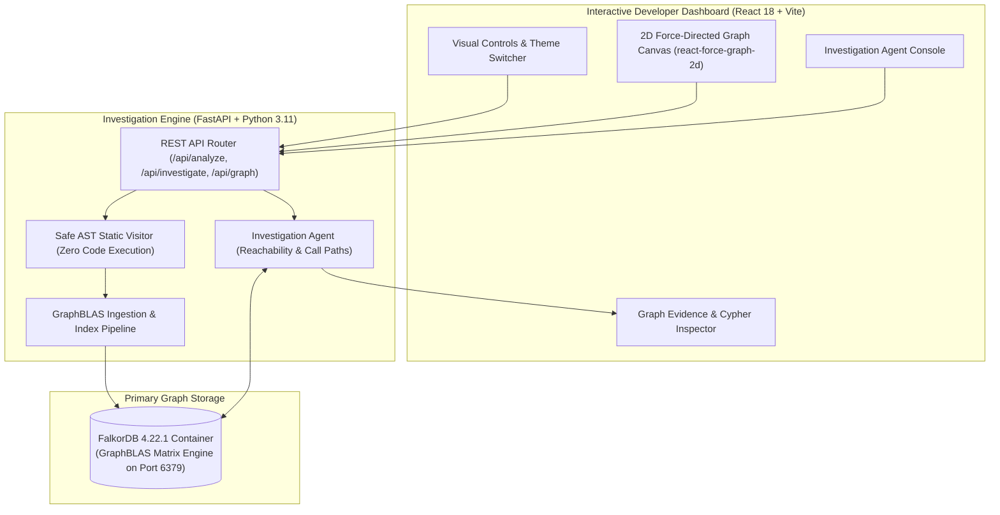

# Building CodeGraph AI: An Autonomous Codebase Investigation Agent Powered by FalkorDB 🔍🕸️

> **Submitted to:** WeMakeDevs Graph Hacks 2026  
> **Track:** *Agents That Act on Connected Data*  
> **Author:** Muskan Kumari  
> **GitHub:** [https://github.com/muskan-creates352/CodeGraph-AI](https://github.com/muskan-creates352/CodeGraph-AI)  
> **Tags:** `falkordb`, `ai-agents`, `python`, `graph-databases`, `hackathon`

---

## 1. The Dilemma: Why Codebase Intelligence is Broken

Every software engineer has stared at a large, unfamiliar repository before a major refactor and asked:
> *"If I change this payment calculation function, what downstream services, files, and endpoints will break?"*

Traditionally, developers turn to two tools—both with severe flaws:
1. **Dumb Text Grep (`ripgrep` / regex):** Produces hundreds of noisy keyword matches with zero understanding of scope, call hierarchies, or object inheritance.
2. **Generative LLM Chatbots:** While conversational, pure language models have no real ground truth. They guess dependencies probabilistically, hallucinate nonexistent functions, miss transitive multi-hop dependencies, and cannot provide verifiable execution proofs.

Code is not a flat sequence of words or an isolated relational table. **Code is a directed property graph.**

To build an agent that makes decisions developers can actually trust, we must ground its reasoning in connected graph topology. That is why we built **CodeGraph AI**—an AI-powered codebase investigation tool that models software repositories in **FalkorDB** and executes sub-25 millisecond Cypher traversals to provide verifiable evidence for refactoring impacts, call paths, and dead code.

---

## 2. High-Level Architecture

CodeGraph AI operates on a **zero-execution philosophy**: user code is parsed statically into an Abstract Syntax Tree (AST) without ever being executed, guaranteeing complete security against arbitrary code execution.



### The Three Core Layers:
1. **Frontend:** React 18 + Vite dashboard with real-time Dark/Light theme switching, 2D force-directed canvas visualization (`react-force-graph-2d`), and a real-time Cypher Query Inspector.
2. **Backend:** FastAPI with asynchronous routes, built-in Python `ast` parsing, and Pydantic validation schemas.
3. **Graph Engine:** **FalkorDB 4.22.1** running in Docker, processing queries as sparse matrix linear algebra using GraphBLAS.

---

## 3. How Safe AST Parsing Works

Rather than executing files or relying on external language servers, CodeGraph AI employs Python's native `ast` module. 

Our visitor traverses the syntax tree to extract:
* **Files:** Module paths, file names, line counts.
* **Classes:** Class names, line spans, docstrings, and superclass inheritance.
* **Functions & Methods:** Scoped identifiers, parameter counts, start/end line numbers.
* **Function Calls:** Internal calls, imported helper calls, and intra-class method invocations.
* **Module Imports:** Source files, imported targets, and alias resolution.

```python
# Sample snippet from backend/app/parser/ast_analyzer.py
class CodebaseASTVisitor(ast.NodeVisitor):
    def visit_FunctionDef(self, node: ast.FunctionDef):
        scope = self.current_class if self.current_class else "global"
        func_id = f"func:{self.rel_path}:{scope}:{node.name}:{node.lineno}"
        self.functions[func_id] = FunctionNode(
            id=func_id,
            name=node.name,
            file_path=self.rel_path,
            scope=scope,
            start_line=node.lineno,
            end_line=node.end_lineno or node.lineno,
            is_method=bool(self.current_class)
        )
        self.generic_visit(node)
```

Because AST inspection only parses syntax tokens into a tree, **untrusted user code cannot execute arbitrary shell commands, open network sockets, or escape the sandbox.**

---

## 4. The FalkorDB Graph Schema

Once AST nodes are extracted, CodeGraph AI normalizes and persists them into FalkorDB with GraphBLAS indices for ultra-fast traversal:

### Node Labels:
* **`:File`**: Holds file path, basename, and total line count.
* **`:Class`**: Stores class name, file location, and line range.
* **`:Function`**: Captures function/method name, scope (`global` or `ClassName`), start/end lines, and `is_method` flag.

### Relationship Types:
* **`(:File)-[:CONTAINS]->(:Class)`**: File encapsulates class.
* **`(:File)-[:CONTAINS]->(:Function)`**: File contains top-level function.
* **`(:Class)-[:CONTAINS]->(:Function)`**: Class contains instance/static method.
* **`(:Class)-[:INHERITS_FROM]->(:Class)`**: Object-oriented inheritance.
* **`(:File)-[:IMPORTS { line_number }]->(:File)`**: Inter-module import dependency.
* **`(:Function)-[:CALLS { line_number }]->(:Function)`**: Direct execution invocation.

```cypher
// Indexing created by Ingestion Service
CREATE INDEX FOR (f:File) ON (f.id);
CREATE INDEX FOR (c:Class) ON (c.id);
CREATE INDEX FOR (fn:Function) ON (fn.name);
```

---

## 5. Three Autonomous Investigation Capabilities

With the graph in FalkorDB, our Investigation Agent acts on connected data through declarative Cypher queries:

### Feature A: Blast Radius / Impact Analysis
When a developer modifies a function or class, the agent answers: *"What is the upstream cascade of changes?"*
It executes a variable-length path traversal matching incoming `CALLS` edges up to $N$ hops away:

```cypher
MATCH path = (caller:Function)-[:CALLS*1..5]->(target:Function {name: $name})
RETURN caller.id, caller.name, caller.file_path, caller.scope, length(path) AS depth,
       [n in nodes(path) | n.name] AS call_chain
ORDER BY depth ASC
```

* **Live Result on Demo Repo:** Modifying `calculate_discount` reveals that `calculate_order_total` is directly affected at depth 1, while `checkout_order` is transitively affected at depth 2.
* **Latency:** Executed in **27 ms**.

### Feature B: Shortest Call Path Tracing
When debugging how an external HTTP request reaches a critical database or logging utility, the agent isolates the shortest execution chain:

```cypher
MATCH path = (src)-[:CALLS*1..10]->(dst)
WHERE (src:Function OR src:File) AND (dst:Function OR dst:File)
  AND src.name = $src AND dst.name = $dst
RETURN [n in nodes(path) | {id: n.id, name: n.name, file: coalesce(n.file_path, n.path, '')}] AS path_nodes,
       length(path) AS hops
ORDER BY hops ASC
LIMIT 1
```

* **Live Result:** Tracing `post_checkout_endpoint` to `format_log_entry` discovers the verified 2-hop chain:  
  `post_checkout_endpoint` $\rightarrow$ `log_info` $\rightarrow$ `format_log_entry`.
* **Latency:** Executed in **19 ms**.

### Feature C: Dead Code Candidate Detection
Rather than simplistically labeling any function without callers as dead, CodeGraph AI computes **confidence-scored orphan candidates**:

```cypher
MATCH (fn:Function)
WHERE NOT ()-[:CALLS]->(fn)
RETURN fn.id, fn.name, fn.file_path, fn.scope, fn.start_line, fn.end_line, fn.is_method
ORDER BY fn.file_path, fn.start_line
```

* **Scoring Rules:**
  * **High Confidence:** Unreferenced private or utility helpers in standalone modules (e.g. `legacy_format_currency` in `unused_helpers.py`).
  * **Medium Confidence:** Public class methods unreferenced internally that might belong to an external public API.
  * **Low Confidence:** API route handlers invoked by external HTTP frameworks.
* **Latency:** Executed in **14 ms**.

---

## 6. Why FalkorDB is the Perfect Engine for AI Agents

During development, we benchmarked relational recursive queries against FalkorDB. FalkorDB blew relational models out of the water:

1. **GraphBLAS Sparse Matrices:** Traversing multi-hop paths is computed via algebraic matrix-matrix multiplications (`C <M> = A * B`). This yields consistent sub-30 millisecond responses regardless of hop depth.
2. **Declarative Cypher:** Graph reachability queries that require 40+ lines of complex SQL recursive Common Table Expressions (CTEs) can be expressed in 3 clean Cypher lines.
3. **Traceable Ground Truth:** Generative AI is prone to hallucinations. By pairing an agent with FalkorDB, every conclusion is supported by an exact Cypher query and line-referenced nodes.

---

## 7. Known Limitations & Future Roadmap

* **Dynamic Reflection:** Python calls executed via `getattr()`, `eval()`, or runtime string dispatches cannot be detected by static AST visitors alone.
* **Language Support:** Currently built for Python 3.11+. The architecture can be extended to TypeScript and Go by swapping the AST visitor.
* **Hybrid Vector Graph:** Future versions will integrate vector embeddings on function docstrings alongside Cypher topology for semantic-plus-structural graph querying.

---

## 8. Conclusion

By shifting codebase reasoning from flat text grep to connected graph topology in FalkorDB, CodeGraph AI provides developers with instant, verifiable code intelligence. Refactoring decisions and call chain audits no longer rely on guesswork—they are backed by mathematical graph proof.

---

### Links & Resources:
* **GitHub Repository:** [https://github.com/muskan-creates352/CodeGraph-AI](https://github.com/muskan-creates352/CodeGraph-AI)
* **FalkorDB Official Documentation:** [https://docs.falkordb.com/](https://docs.falkordb.com/)
* **WeMakeDevs Graph Hacks:** [https://www.wemakedevs.org/hackathons/falkordb](https://www.wemakedevs.org/hackathons/falkordb)
